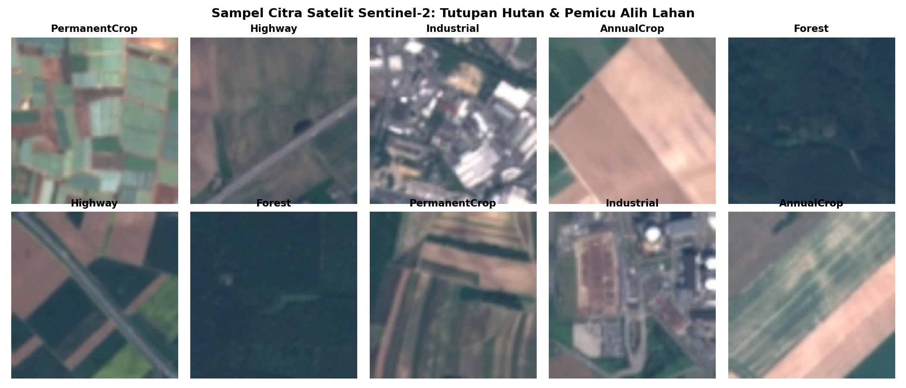
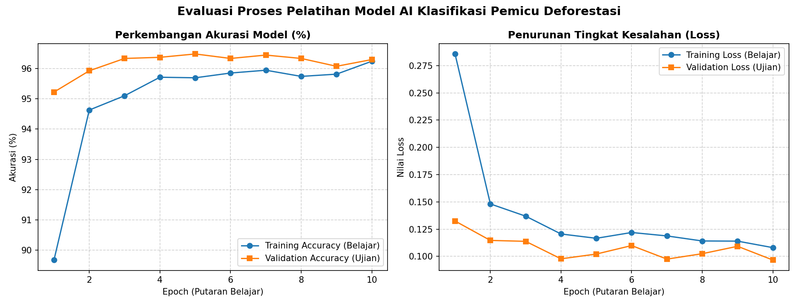
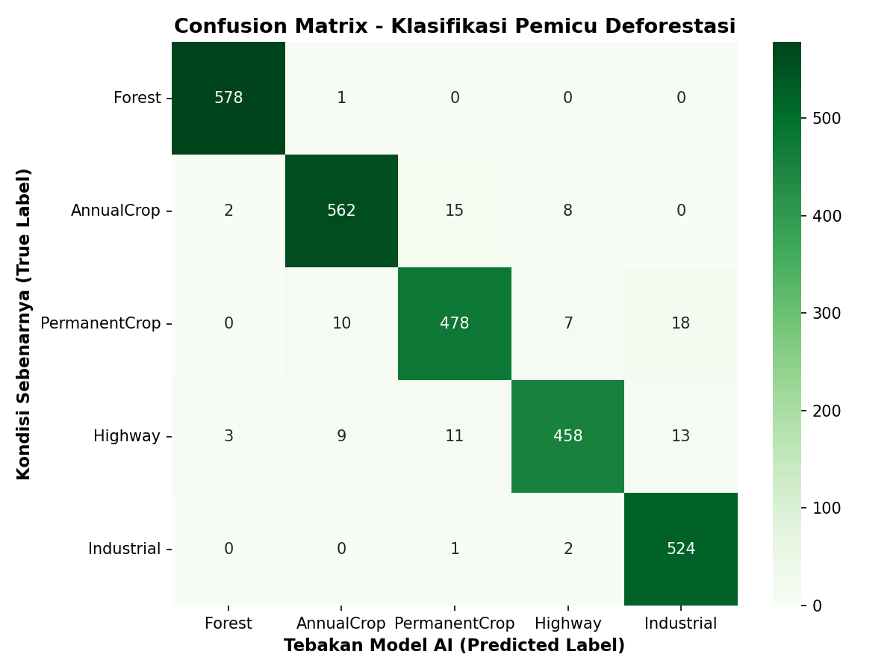
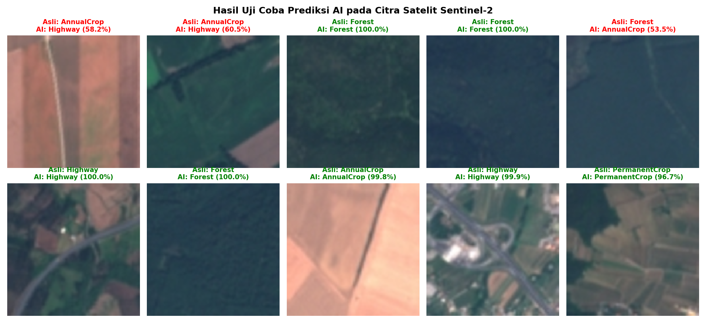

# Klasifikasi Otomatis Pemicu Langsung Deforestasi (*Direct Drivers of Deforestation*) Menggunakan Citra Satelit dan *Deep Learning*

Repositori ini merupakan implementasi studi kasus dari **Informatics Practitioner Lecture Series** (Program Studi Informatika, Fakultas Teknik, Universitas Bengkulu) dengan topik **"Attributing Direct Drivers to Deforestation Alerts with Satellite Imagery and AI"**.

---

## 1. Latar Belakang & Permasalahan
Sistem peringatan dini pemantauan hutan berbasis satelit mampu mendeteksi lokasi dan waktu terjadinya kehilangan tutupan pohon secara *near-real-time*. Namun, tantangan utama dalam upaya konservasi dan penegakan kebijakan adalah mengidentifikasi **faktor pemicu langsung (*direct drivers*)** dari deforestasi tersebut secara cepat dan berskala luas tanpa harus memeriksa ribuan citra satelit satu per satu secara manual.

Proyek ini mengimplementasikan model *Computer Vision* berbasis **Convolutional Neural Network (CNN)** dengan pendekatan **Transfer Learning (MobileNetV2)** pada citra satelit **Sentinel-2 (EuroSAT)** untuk mengklasifikasikan kondisi tutupan hutan dan empat kategori utama pemicu alih fungsi lahan.

---

## 2. Dataset Citra Satelit
Dataset yang digunakan adalah citra satelit **Sentinel-2 RGB (EuroSAT)** yang dikurasi ke dalam **5 kelas utama** dengan total **13.500 citra satelit** (resolusi `128x128` piksel):

| Kelas Lahan | Jumlah Citra | Representasi pada Studi Kasus Deforestasi |
| :--- | :---: | :--- |
| **1. `Forest`** | 3.000 | Tutupan hutan primer/sekunder (Kondisi Non-Deforestasi) |
| **2. `AnnualCrop`** | 3.000 | Pemicu Deforestasi: Pembukaan lahan untuk pertanian musiman / skala kecil (*Smallholder Agriculture*) |
| **3. `PermanentCrop`** | 2.500 | Pemicu Deforestasi: Perkebunan komoditas tahunan / industri |
| **4. `Highway`** | 2.500 | Pemicu Deforestasi: Pembangunan infrastruktur jalan raya / akses pembalakan (*Logging/Transport Roads*) |
| **5. `Industrial`** | 2.500 | Pemicu Deforestasi: Ekspansi kawasan industri dan ekstraksi/pertambangan |
| **Total Keseluruhan** | **13.500** | **80% Data Latih (10.800 citra) & 20% Data Uji/Validasi (2.700 citra)** |

### Visualisasi Sampel Citra Satelit Sentinel-2

---

## 3. Metodologi & Arsitektur Model AI
Tahapan pemrosesan dan pemodelan yang diterapkan dalam buku catatan [`Studi_Kasus_Deforestasi_AI.ipynb`](Studi_Kasus_Deforestasi_AI.ipynb) meliputi:
1. **Pra-pemrosesan & Pembagian Data (*Data Splitting*):** Membagi 13.500 citra menjadi **10.800 citra *training* (80%)** dan **2.700 citra *validation* (20%)** dengan penyeragaman dimensi `128x128x3` serta normalisasi rentang nilai piksel ke `[-1, 1]`.
2. **Augmentasi Data (*Data Augmentation*):** Menerapkan *Random Horizontal & Vertical Flip* serta *Random Rotation* (`0.2`) untuk mengatasi variasi sudut pengambilan citra dari satelit.
3. **Arsitektur *Transfer Learning* (`MobileNetV2`):**

   Menggunakan *backbone* `MobileNetV2` (*pre-trained* pada ImageNet) sebagai ekstraktor fitur spasial dan spektral.
   
   Menambahkan *GlobalAveragePooling2D*, *Dropout Layer* (`0.2`) untuk mencegah *overfitting*, dan *Dense Layer* (`5 neuron`, aktivasi `Softmax`).
   
   Model dikompilasi menggunakan *optimizer* `Adam` (`learning_rate = 0.001`) dan fungsi *loss* `Sparse Categorical Crossentropy` selama **10 Epoch** pada akselerator **NVIDIA T4 GPU**.

---

## 4. Hasil Eksperimen & Evaluasi Model

### 4.1. Perkembangan Akurasi dan Penurunan *Loss*
Selama 10 *epoch* pelatihan, model menunjukkan konvergensi yang stabil tanpa gejala *overfitting* dan berhasil mencapai **Validation Accuracy tertinggi sebesar 96.48%**.

### 4.2. Evaluasi Performa per Kelas (*Classification Report*)
Pengujian dilakukan terhadap **2.700 citra satelit pada data validasi** dengan rincian metrik evaluasi sebagai berikut:

| Kelas | Precision | Recall | F1-Score | Jumlah Sampel (*Support*) |
| :--- | :---: | :---: | :---: | :---: |
| **`Forest`** | 0.9914 | 0.9983 | 0.9948 | 579 |
| **`AnnualCrop`** | 0.9656 | 0.9574 | 0.9615 | 587 |
| **`PermanentCrop`** | 0.9465 | 0.9318 | 0.9391 | 513 |
| **`Highway`** | 0.9642 | 0.9271 | 0.9453 | 494 |
| **`Industrial`** | 0.9441 | 0.9943 | 0.9686 | 527 |
| **Overall Accuracy** | | | **0.9630 (96.30%)** | **2.700** |
| **Macro Average** | **0.9624** | **0.9618** | **0.9619** | **2.700** |
| **Weighted Average** | **0.9631** | **0.9630** | **0.9628** | **2.700** |

### 4.3. Analisis *Confusion Matrix*

**Deteksi Tutupan Hutan Sangat Presisi:** Kelas `Forest` mencapai nilai *F1-Score* **99.48%**, menunjukkan bahwa model sangat andal dalam membedakan kanopi hutan utuh dari area yang telah mengalami deforestasi.

**Identifikasi Kawasan Industri & Pertanian:** Kelas `Industrial` meraih *Recall* **99.43%** (524 dari 527 citra berhasil dikenali dengan tepat), diikuti oleh `AnnualCrop` dengan *F1-Score* **96.15%**.

### 4.4. Uji Coba Prediksi & Analisis Ambiguitas Visual

Pada uji sampel acak di atas, model memprediksi mayoritas citra dengan tingkat keyakinan (*confidence score*) mencapai **96.7% hingga 100.0%**.

Kasus kesalahan prediksi yang muncul (berwarna merah dengan *confidence* rendah di kisaran **53.5%–60.5%**) terjadi pada citra `AnnualCrop` yang memiliki jalur pemisah lurus menyerupai jalan raya (`Highway`), serta area perbatasan `Forest` dan `AnnualCrop`. Temuan ini selaras dengan materi kuliah praktisi mengenai tantangan **ambiguitas visual antar-kelas** pada citra satelit resolusi menengah.

---

## 5. Struktur File Repositori

`Studi_Kasus_Deforestasi_AI.ipynb` — *Source code* lengkap Google Colab (mulai dari pengunduhan data, pra-pemrosesan, pelatihan model CNN/MobileNetV2, hingga evaluasi).

`sample_satellite_images.png` — Visualisasi sampel dataset citra satelit Sentinel-2.

`training_history.png` — Grafik kurva *Training vs Validation Accuracy & Loss*.

`confusion_matrix.png` — Peta evaluasi *Confusion Matrix* pada 2.700 data uji.

`prediction_results.png` — Hasil uji coba prediksi model beserta nilai *confidence score*.
